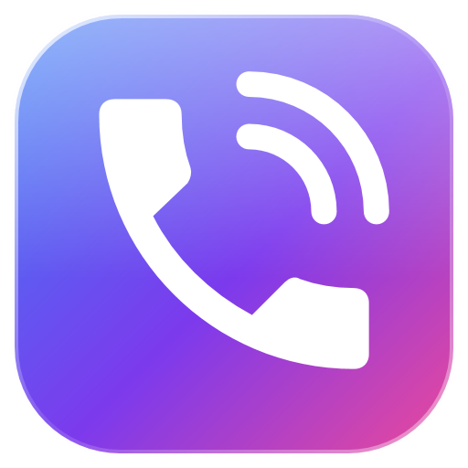
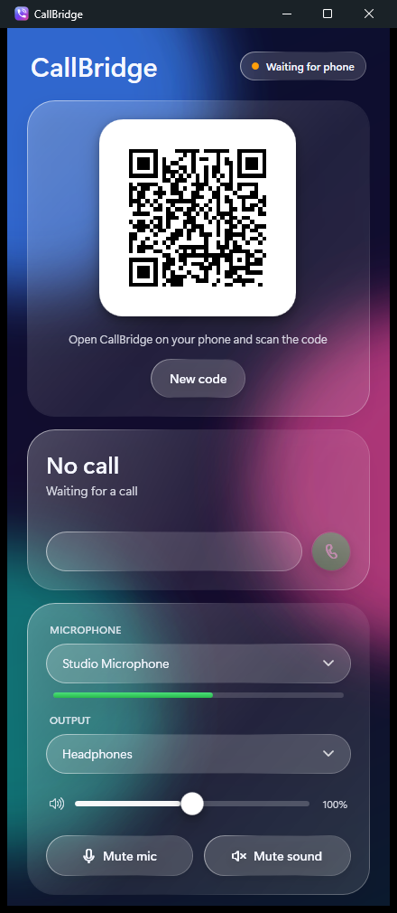
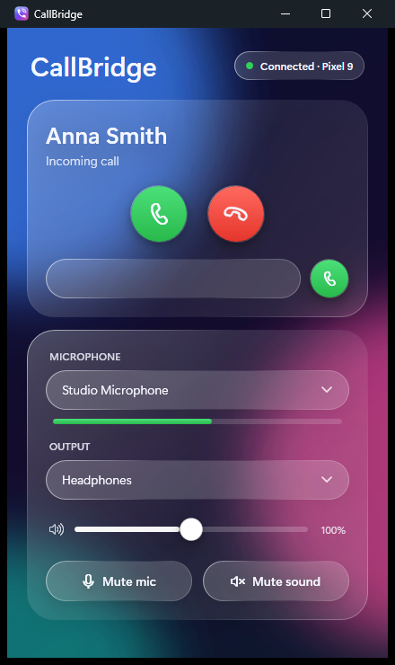
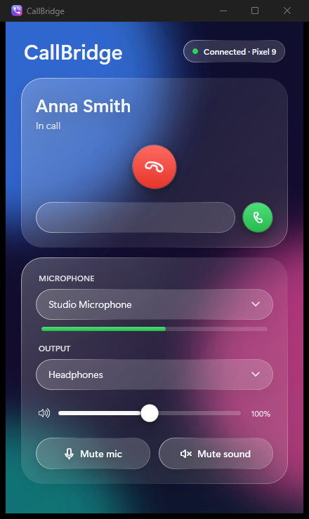
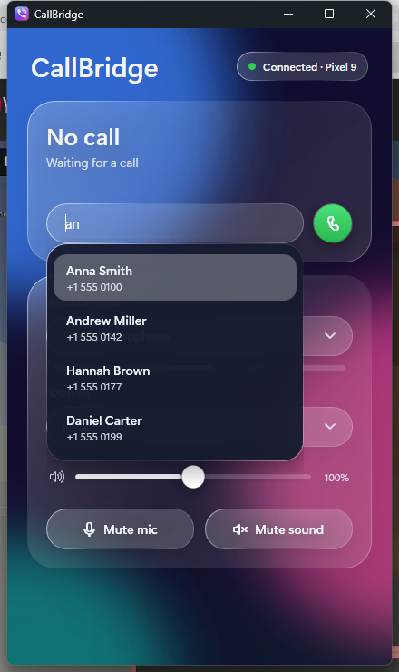
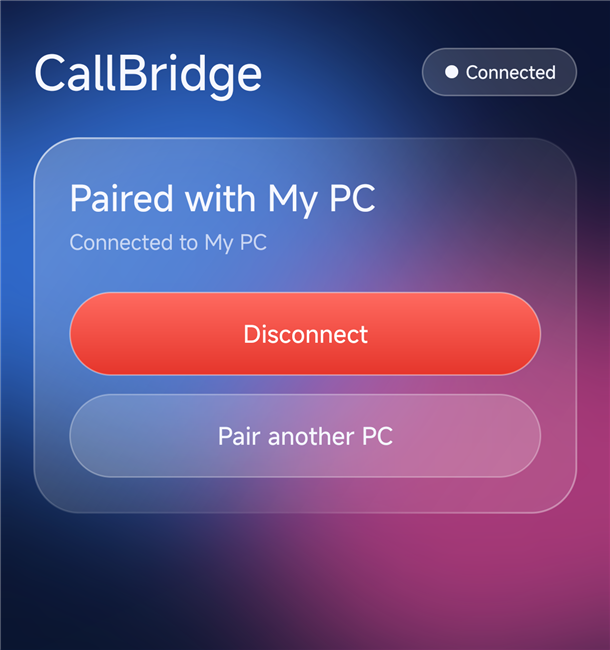

<p align="center"></p>

<h1 align="center">CallBridge</h1>

<p align="center">Take phone calls on your Windows PC: pick any mic and headphones, mute, and more. Android app + Windows .exe</p>

<p align="center">
	
	
	
	
</p>

<p align="center"></p>

The phone stays in your pocket. Its cellular call audio is streamed to the PC, so you hear the caller in the headphones you choose and talk into the microphone you choose.

## Status

| Part | State |
|------|-------|
| Windows app (WPF, WASAPI, Opus), tray, incoming call notification | works: device pickers, volume, mute, answer / reject / hang up / dial with contact suggestions |
| Android app: call state, answer, hang up, dial, QR pairing | implemented |
| Android app: caller audio to PC | implemented (`VOICE_DOWNLINK`), needs the app installed as a system app |
| PC microphone into the call | works: an AudioTrack routed to the telephony transmit device, the phone itself stays silent during the call |


## Requirements

- Android 12+ with root (Magisk). Tested on Redmi K50 Ultra, HyperOS 3 (Android 15).
- Windows 10/11.

## Install

Download from the [releases page](https://github.com/Moscow146/callbridge/releases) (or the artifacts of a [workflow run](https://github.com/Moscow146/callbridge/actions)):

- `CallBridge.exe`: the Windows app, a single self-contained file.
- `callbridge-magisk.zip`: flash it in the Magisk app and reboot. It installs CallBridge into `/system/priv-app`, grants `CAPTURE_AUDIO_OUTPUT` and the runtime permissions.

## Use

1. Start `CallBridge.exe`. It shows a QR code and lives in the tray when the window is closed.
2. Open CallBridge on the phone, tap Scan QR code and point the camera at the QR. The pairing is remembered, next time just tap Connect.
3. Over USB instead of Wi-Fi: `adb reverse tcp:47800 tcp:47800`. The QR already contains `127.0.0.1`.
4. Call the phone, the PC shows the caller and Answer / Reject buttons.

## Build

Windows (.NET 10 SDK):

```powershell
dotnet test windows\CallBridge.sln
.\scripts\publish-windows.ps1
```

Android (JDK 17+, Android SDK with platform 36):

```powershell
.\scripts\build-android.ps1 -Module
```

The result is `build\callbridge-magisk.zip`. Icons are generated by `scripts\make-icons.ps1`.

Protocol: [docs/PROTOCOL.md](docs/PROTOCOL.md).
