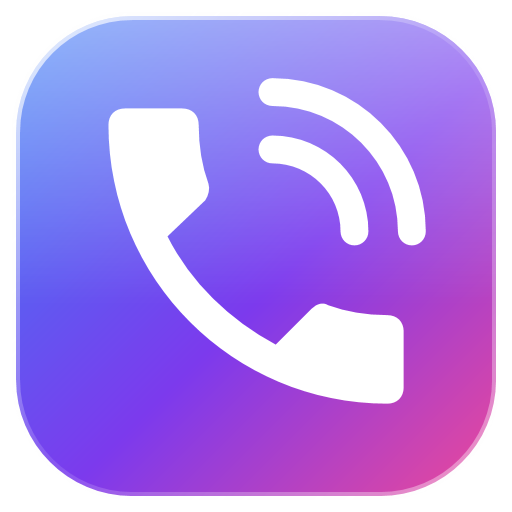
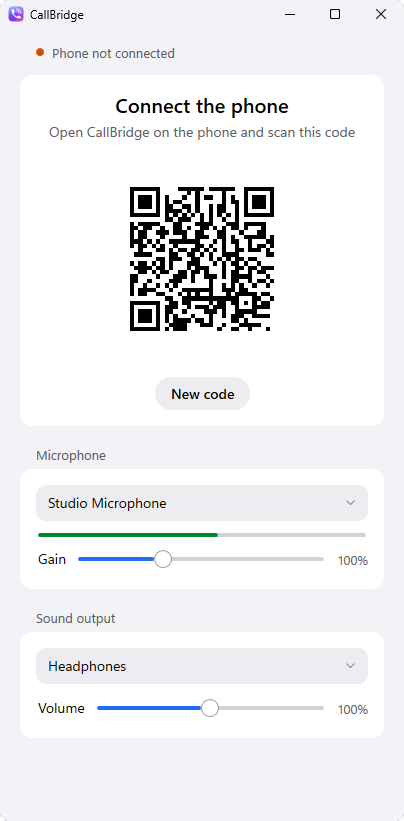
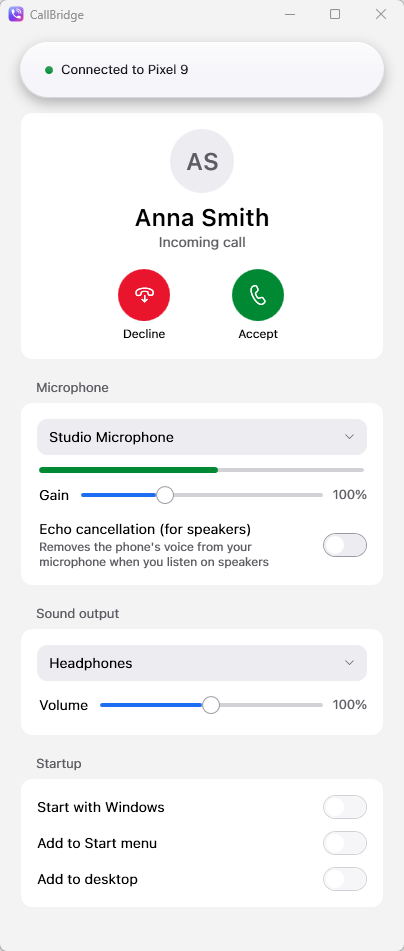
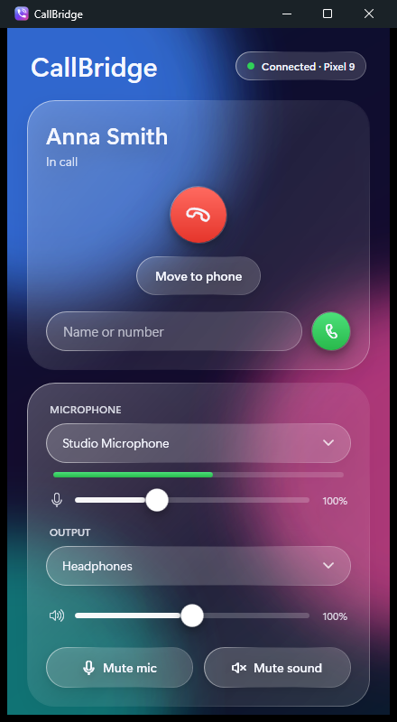
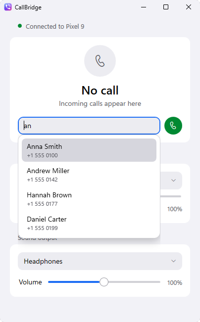
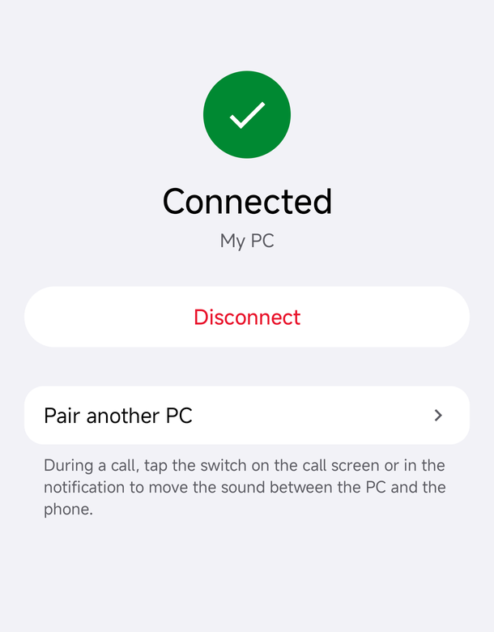

<p align="center"></p>

<h1 align="center">CallBridge</h1>

<p align="center">
	<a href="https://github.com/Moscow146/callbridge/actions/workflows/build.yml"></a>
	<a href="https://github.com/Moscow146/callbridge/releases/latest"></a>
	<a href="LICENSE"></a>
	<a href="https://moscow146.github.io/callbridge/"></a>
</p>

<p align="center">Take phone calls on your Windows PC: pick any mic and headphones, mute, and more. Android app + Windows .exe</p>

<p align="center">
	<picture><source media="(prefers-color-scheme: dark)" srcset="docs/screenshots/windows-pairing-dark.png"></picture>
	<picture><source media="(prefers-color-scheme: dark)" srcset="docs/screenshots/windows-ringing-dark.png"></picture>
	<picture><source media="(prefers-color-scheme: dark)" srcset="docs/screenshots/windows-call-dark.png"></picture>
	<picture><source media="(prefers-color-scheme: dark)" srcset="docs/screenshots/windows-suggest-dark.png"></picture>
</p>

<p align="center"><picture><source media="(prefers-color-scheme: dark)" srcset="docs/screenshots/android-connected-dark.png"></picture></p>

The phone stays in your pocket. Its cellular call audio is streamed to the PC, so you hear the caller in the headphones you choose and talk into the microphone you choose.

## Status

| Part | State |
|------|-------|
| Windows app (WPF, WASAPI, Opus), tray, incoming call notification | works: device pickers, volume, mute, answer / reject / hang up / dial with contact suggestions |
| Android app: call state, answer, hang up, dial, QR pairing | implemented |
| Android app: caller audio to PC | implemented (`VOICE_DOWNLINK`), needs the app installed as a system app |
| PC microphone into the call | works: an AudioTrack routed to the telephony transmit device, the phone's speaker and microphone stay silent during the call |
| Call modes | works: move a running call between the PC and the phone from the PC app, a floating button on the phone, or the notification |


## Requirements

- Android 12+ with root (Magisk). Tested on Redmi K50 Ultra, HyperOS 3 (Android 15).
- Windows 10/11.

## Install

Download from the [releases page](https://github.com/Moscow146/callbridge/releases) (or the artifacts of a [workflow run](https://github.com/Moscow146/callbridge/actions)):

- `CallBridge.exe`: the Windows app, a single self-contained file.
- `callbridge-magisk.zip`: flash it in the Magisk app and reboot. It installs CallBridge into `/system/priv-app`, grants `CAPTURE_AUDIO_OUTPUT`, `MODIFY_PHONE_STATE` (to play the PC microphone into the call), `CONNECTIVITY_USE_RESTRICTED_NETWORKS` (so the bridge keeps working while a VPN is on), the runtime permissions and the floating button.

## Use

1. Start `CallBridge.exe`. It shows a QR code and lives in the tray when the window is closed.
2. Open CallBridge on the phone, tap Scan QR code and point the camera at the QR. The pairing is remembered, next time just tap Connect.
3. Over Wi-Fi the PC must accept connections: run `.\scripts\allow-firewall.ps1` once (it asks for administrator rights and opens TCP 47800 and UDP 47801 on private networks). If the PC address changes, the phone finds the PC again by itself.
4. Over USB instead of Wi-Fi: `adb reverse tcp:47800 tcp:47800`. The QR already contains `127.0.0.1`.
5. Call the phone, the PC shows the caller and Answer / Reject buttons.
6. A call starts on the PC, with the phone's speaker and microphone silent. To move it, press To phone in the PC app, the floating button over the phone's call screen (drag it if it is in the way), or the action in the CallBridge notification. If the connection to the PC is lost, the call continues on the phone.

Keyboard shortcuts in the PC app: Ctrl+Enter accepts a call, Ctrl+E ends it, Ctrl+M mutes the microphone and Ctrl+D turns off the caller's sound.

With a VPN on the phone the bridge still talks to the PC over Wi-Fi. [How to check it and what the log shows](docs/NETWORK-CHECK.md).

Keep Bluetooth headsets disconnected from the phone during calls on the PC: the HAL refuses to mute a Bluetooth headset's microphone, so it would stay live in the call.

## Build

Windows (.NET 10 SDK):

```powershell
dotnet test windows\CallBridge.sln
.\scripts\publish-windows.ps1
```

Android (JDK 17+, Android SDK with platform 36):

```powershell
.\scripts\build-android.ps1 -Module
```

The result is `build\callbridge-magisk.zip`. Icons are generated by `scripts\make-icons.ps1`.

Protocol: [docs/PROTOCOL.md](docs/PROTOCOL.md).
